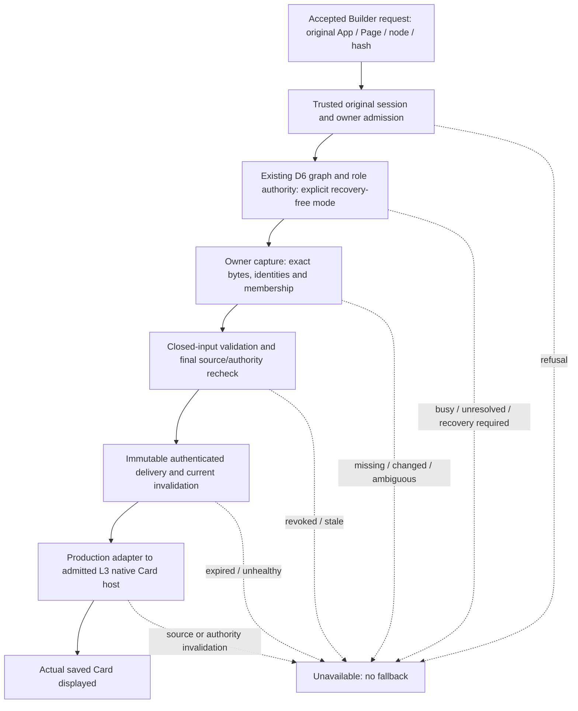

# WP5-F / D6 Production Preview Unblocking — architecture decision

2026-10-26. **Decision for review; no implementation or protected execution is authorized by this document.** The accepted request path can identify the retained saved Card, but it cannot acquire a fresh coherent capture, authorize disclosure or render it. No further UI-only readiness increment is recommended: no independently proven UI blocker was found in the accepted integration evidence.

The first recommended implementation is **D6-R1 Recovery-Free Read Admission Contract**, inside the existing Foundation owner. This is a concrete safety prerequisite for a future protected qualification run while recovery remains prohibited. It does not claim to fix historical failures, make unavailable source readable, or close D6. Useful ordinary-source implementation can proceed with isolated tests; genuine saved Preview cannot activate until the narrow D6 operational gate and independent authority/delivery gates pass.

## Request-to-render dependency diagram

The standalone diagram is `builder-v1-wp5-f-preview-unblocking-flow-20261026.mmd`.

The diagram is a dependency path, not a claim that the middle boxes exist. Authority must approve reads before capture; D6 cannot supply permission. Immutable delivery is independently required even after a coherent read.

## Source-backed findings and exact blocker matrix

All findings below come from ordinary implementation text, accepted contracts/reports and retained evidence. Product modules/readers were not imported or executed. No lock, journal, current owner/PID, saved Component, registry database or endpoint was inspected. Historical failures are not current diagnoses.

| Boundary | Exists and can be reused | Actual gap / class | Evidence and acceptance needed |
| --- | --- | --- | --- |
| Builder selection/request | Actual source-owner reader, adapter/coordinator, shell/view and SavedPreviewRequestController preserve App, owner-qualified Page, node/hash, canonical Definition/package and generations | **Implementation complete within accepted metadata scope.** Provider intentionally unavailable; retained hash is not a fresh capture | Accepted 41-test/18-checkpoint integration evidence; no more readiness UI work needed |
| Saved Page owner | `VisualArtifactService` in server/visual-artifacts.ts owns the five Visual roles and SHA-256(JSON.stringify(files)); Page root is authoritative Application root/src/pages | **Acquisition implementation gap:** no production capture endpoint/function resolving the request to a fresh immutable candidate under original authority | Resolve permanent Page identity through the existing owner, not a client locator/key alone; exact role/hash/identity and membership rechecks |
| Shared saved Component owner | Same service owns platformComponentsRoot; visualWorkspace enumerates/validates Page/Shell/Component bundles | **Operational + scope gap:** required shared identity membership and transitive dependencies may enter protected roles. Retained ids are not a current uniqueness proof | Authorize every required owner/read scope; include required membership/duplicate detection. Do not skip a blocked shared Component to get a pass |
| Installed canonical Card | component-registry.ts uses getActiveAppPackages/packageEntries and retains explicit manifest Definition/package metadata; native profile pins @ui-base/ui 0.5.1 and exact module bytes | **Implementation + writer-coverage gap:** package version/manifest label is not an immutable executable/resource snapshot; inferred metadata is insufficient | Package owner supplies explicit canonical metadata, activation/export resolution and byte digests for the admitted closure; detect same-version byte changes, duplicate identities and activation changes |
| Graph admission | composition-lock.ts → withRoleBundleGraph(platformRoot/components); runtime-read-admission.ts delegates once; role/source checks remain Foundation-owned | **Implemented primitive, operational qualification open.** Queue budget/cancellation/no-replay are not complete capture or arbitrary-writer coherence | Same canonical graph root/identity for all participants, graph→role order, callback-once evidence, bounded busy refusal and complete writer participation |
| Read side effects | role-bundle.ts:locked calls recoverTransaction before capture; list() calls recoverRoleBundleRoot; storage.ts may reclaim an ESRCH owner through a recovery guard | **Concrete source-contract gap:** current reader is not recovery-free. A read may write/roll back source or remove an old lock | New explicit fail-closed mode in the same owner, propagated end-to-end. Pending journals, unresolved/dead-owner situations requiring recovery refuse. No caller-side journal/lock scanner or bypass |
| Legacy focused acquisition | visual-preview.ts:visualPreviewRevision holds graph admission, verifies expected hash, discovers Components/Shells, checks related access and rereads participants/composition | **Reuse patterns only.** Broad discovery can touch protected data; code isolation/live package URLs and partial package/membership rechecks are not the production immutable capture contract | Refactor owner resolution/admitted capture helpers rather than invoke the HTTP handler or nest graph acquisition. Complete required roles/collections/native resources; no legacy URL fallback |
| D6 reliability | D6 source changes and historical regressions demonstrate useful admission work | **Operational evidence unresolved**, not proof of one current lock failure | Reports retain 488/489, later 500/501 and focused 56/62 on different workloads. Correlate failing phase/request/root/typed outcome; preserve ordinary runtime persistence and simultaneous-use behavior before qualification |
| Real subject/session | V1DevelopmentIdentity.currentUser/authorize/captureAdmission; ArtifactEditorSecurity.workspacePrincipal and existing session/CSRF handling | **Reusable checks; production Preview adapter missing.** Client subject/session metadata and a cookie handle are not a grant | Rebind from original trusted server request, enforce original session before/after async work and expiry/revocation; never trust client-selected subject as authority |
| Permanent Application owner | DevelopmentApplicationRegistry.byKey/byApplicationId/provisioning.resolve and manifest/settings checks | **Reusable owner authority; invalidation contract incomplete.** revision() is a digest, not a durable owner event cursor | Confirm registered permanent UUID and active owning Application, preserve key/UUID binding, invalidate deletion/disable/remap. No owner transfer or manifest-adoption shortcut |
| Access policy and invalidation | Existing I-AM evaluator/definition store and captureAdmission; L2-A identifies security_audit and activation writers | **Implementation + security evidence gap:** complete durable history/lineage, all writers, session/owner signals, reconnect/gap/expiry fencing and health are not operationally qualified | Authority-owned history/reconcile adapter; audit reuse before any outbox/migration decision. File watchers/SSE filtering/process-local notifications are not committed policy authority |
| Immutable delivery | L1/L2 normalizeManifest, byte digests, Binding/Epoch and prepare/send contracts; model bytes/index and limits | **Production implementation absent.** Models consume supplied observations/allow answers; no real route/store/resource admission follows from their passing vectors | Server-held sealed bytes/index; fresh original authority on every capture/resource disclosure; exact content/media/length binding, expiry and no-store; no live file/module fetch fallback |
| Source-to-native mapping | L3 admission/host/frame and actual renderComponentInstance(preview:true), strict finite Card settings and exact bundle/Definition/native closure | **Production adapter missing.** L3 binding.selectedIdentity is canonical package Card, not saved Page/node; host/frame use authored time/allow context | Preserve source binding and implementation binding together; current real authority gates parent delivery/activation. Never retarget the saved Page identity to CARD_ID or treat frame allowed:true as server authority |
| Bounds and disclosure race | Accepted L2 activation-blocking requirements, existing one-frame-per-host sequencing and CSP/sandbox | **Security decisions/evidence outstanding:** no production heartbeat/lag/clock, resource/capture/concurrency/retention/lease ceilings or real check-to-send boundary qualified | Approve measured limits and connected-client assumptions; missing config/health/gap/expiry means unavailable. Already-sent bytes and frozen clients cannot be promised instant erasure |

Relevant ordinary source: packages/artifacts/src/{storage,role-bundle,storage-api}.ts; packages/visual-artifacts/src/runtime-read-admission.ts; src/server/{visual-artifacts,visual-preview,component-registry,composition-lock,builder-workspace,v1-development-identity,development-application-registry,editor-security}.ts; src/preview-contract-model/{model,acquisition}.ts; src/client/native-card-preview/{admission,host,frame}.ts. These references are inspection, not execution admission.

## D6: what specifically must change and what must be qualified

Existing graph/role acquisition protects cooperating writers, not policy, package installers, arbitrary external edits or multi-artifact filesystem-wide ACID. `AcquisitionModel` validates supplied first/validation observations; it does not read source. `visualPreviewRevision` is the closest existing orchestration pattern, not a ready production provider. Calling the editor authorize route from inside another graph callback would also risk nested admission; shared internal owner helpers must preserve the existing lock order.

**The chosen first code step is an optional recovery-free read contract**, not lock repair or another acquisition model. Keep existing defaults for unrelated callers. For the new mode, the Foundation owner must refuse recovery-required/ambiguous state, preserve acquisition-only waiting and callback-once behavior, and prevent role/root recovery paths from running. `VisualArtifactService` must propagate that mode through list/read to the same owner. Reading under this mode still requires normal acquisition metadata writes: creating/writing/closing/unlinking one's own coordination lock is not a claim of zero filesystem writes. No stale/foreign lock deletion, journal replay, source repair or owner inference is permitted.

This is necessary to keep the next operational request within a no-recovery boundary: prechecking a directory and then calling today's default recovering reader does not provide that guarantee. The new mode may only produce a refusal on an unhealthy installation; that is correct, and is **not** a correction of the historical failure or permission to investigate the machine.

**Specific separately authorizable D6 operational decision:** approve a recovery-free, acquisition-only qualification for one named permanent Application/Page/Card and its complete declared closure, on explicitly approved canonical roots/hosts, using real read authority and the existing graph/role owner. Permit authority-owned coordination/recovery-status metadata reads and authorized source-content reads, with writes limited to the caller's own normal coordination metadata. No journal contents or foreign ownership metadata are disclosed to the browser. Require competing participating writers/ordinary runtime to remain present in the approved bounded workload. No current target ids/roots are nominated by inspecting protected state in this decision; they must be resolved/approved from the trusted original request and owner services at that gate.

Before that request can be approved: pass the new mode's isolated tests; provide exact deployed executable/root/writer inventory and permission-to-role map; approve the literal/native/theme subset and closure membership; supply redacted historical failure correlation and the real authority read-admission adapter. Evidence must show complete bytes/revisions/identity/membership, deterministic no-replay and no-recovery refusals, actual denied/stale/busy cases, source change during capture and ordinary runtime/edit preservation. Content/hash metadata must not be logged as policy/source payloads beyond the approved evidence plan.

If the approved attempt reports unresolved ownership, recovery required, access denial, alias/root mismatch, missing membership or acquisition exhaustion, **stop with typed evidence and keep Preview unavailable**. No timeout increase, silent role exclusion, independent lock deletion or recovery follows. A Foundation-authority disposition of that specific refused state would require a later separate operational decision. Windows/token/elevation/VM/WinPE and recovery investigations remain paused. No genuine saved Preview can bypass this gate; a narrow successful capture does not itself accept all of D6 or erase its unresolved regression history.

## Exact smallest content and native closure

For the first real slice, select an already existing saved Card that meets the approved subset; do not create sample content or modify protected source to manufacture eligibility. Capture the Page's .html/.css/.visual.json/.fixtures.json/.functions.ts as exact role bytes, stable Page/node identity and content hash; source-owner identity/dependency membership needed to rule out collisions; authoritative Application ownership/presentation inputs needed to decide theme/context; explicit canonical package manifest/package metadata/export/activation; and the fixed native bundle/Definition fingerprints. Missing/denied/unreadable roles are not empty content. New files/add/remove/rename and same-version package changes must be detected.

Start with literal, text-only static Card settings in mode none, with no services, actions, expressions, user functions, HTML slot markup, image/icon/font URLs or unqualified Shell/theme/Page CSS effects. The existing source-owner metadata subset is not a rendering-semantics proof: child markup or contextual CSS must not be silently dropped. Require proved absence/equivalence to the admitted native default theme, or stop for a specific capture/projection extension. Canonical declared defaults may be used only as part of the pinned real Definition; authored fixture defaults/sample content must never substitute for saved values. The eligible target's existence is unknown until separately authorized acquisition; no claim is made that today's selected Page satisfies it.

Reuse the L3-B exact 13-module closure recorded in evidence/builder-v1-wp5-f-l3b-20261024/native-admission-before-code.json: UI renderer/registry/definition/Card/layout; Core index/utils/localization/validation/metadata/base-element; Icons uib-icon/icon-registry, with their package/Definition hashes. Its fixed registrations/MutationObserver effects were admitted, not represented as absent. Only the intended Card is constructed. No fetching loadCardRegistry, handler/service registration, dynamic imports, arbitrary icons, class/custom CSS fallback or live moduleUrl execution. Preserve existing sandbox allow-scripts with opaque origin/credentialless and exact hashed bootstrap CSP, connect/img/font/media/object/frame/worker/base/form restrictions. Changed installed bytes/export/version are unavailable until separately admitted, not relabeled as the old profile.

The production envelope must retain the accepted source selection plus native implementation mapping. L1/L2 source owner/selected identity and L3 package Card binding are different domains; an outer checked mapping must bind both to the same original subject/session/Application and current epoch. Content identity hashes the immutable bytes/index, separately from authority epoch. L3's supplied now/allowed context and authored status are not a production clock or authority; use a qualified parent activation/lifecycle adapter around the existing native host, not a new renderer/controller or a copied demo. It must freshly admit before sending/activating and remove protected display on source/authority/health uncertainty. Reuse one-frame-per-host sequencing and reject old completions; global/per-subject server concurrency, bytes/resources, retention and lifetime still need approved bounds.

Protected bytes reach the parent only through immutable capture/resource handles with fresh authority and exact digest/index/media/length checks, then the restricted native host receives admitted data and the pinned trusted bundle. No resource is resolved from current filesystem/package/asset URLs after capture. First slice needs no external media resources. On observed source change the conservative first-slice policy is to clear the old native instance/protected summary and require explicit Preview again; on revocation/expiry/gap/unhealthy channel, hide before asynchronous cleanup and deny future delivery. Reconnect never automatically restores prior bytes. The real disclosure-race boundary and client event-loop limitations must be approved before activation.

## One prioritized implementation sequence

Each row is a separate future authorization and acceptance gate; none is authorized by this decision.

| Order / dependency | Implementation required and reuse | Security evidence / execution environment | Still prohibited / stop condition |
| --- | --- | --- | --- |
| **1. D6-R1 Recovery-Free Read Admission Contract** | Optional mode in existing Foundation graph/role/root reads and Visual owner propagation; reuse canonical roots, lock order, typed outcomes, queue/cancellation and callback-once semantics. No capture success/provider/UI work | Ordinary source implementation; exact isolated in-memory/fault-injected tests of actual primitives, no current state/process probes. Preserve defaults/history | No live protected read, lock/journal repair or runtime/authority execution. Stop if this requires a new lock authority/format, owner inference, migration or weakening default safety |
| **2. D6-R2 Real Owner Capture Boundary**; depends on 1 | Implement a real server acquisition function, not a synthetic controller/model: shared owner identity resolution, complete role/package/membership descriptor, literal semantic projection, immutable byte candidate, validation/reacquisition rechecks. Reuse owner services/graph, parser/validator, L1 content rules and accepted request identity. Production provider stays off | Approved exact source/writer/root and permission-role map; memory transports plus separately admitted disposable nonprotected fixtures only. No fixture allow answer becomes production authority | No live protected source. Stop on uncoordinated required writer, unsupported semantics/theme/resource, missing identity/membership or a need for an unapproved source/owner catalog. Any installer/writer protocol expansion needs explicit scope first |
| **3. A1 Real Authority/Invalidation Adapter and Activation Policy**; needed before operational capture/disclosure | Reuse original V1 captureAdmission/evaluator/editor session/registered owner. Implement L2 authority-owned history/reconcile, original binding/epoch, session/owner/expiry/gap/health invalidation. Approve actual delivery/race/clock/limit semantics | Audit all deployed activation writers and whether existing same-transaction security_audit supports lineage/replay/retention. Ordinary-source code can be isolated first; real authority tests require separate environment/database-read authorization | No I-AM database or owner transition under current/first code authorization. Stop for separate migration approval if an outbox/history change is necessary; missing bounds/coverage keeps provider off |
| **4. O1 Narrow D6 + authority operational capture gate**; depends on 1–3 | Qualify the real R2 function and read-authority binding on the approved existing saved target/closure, without rendering or exposing bytes to the browser. Reuse the same root/role protocol and ordinary runtime | Explicit protected acquisition-only authorization described above; real contention/currentness/refusal/revocation tests, failure-phase correlation and ordinary runtime preservation | No source/Component changes, recovery, policy mutation or Windows investigations bundled. Any refused/ambiguous state stops. Does not close entire D6 or accept rendering |
| **5. T1 Immutable Delivery + Existing Native Host Activation**; depends on passing 3–4 | Implement bounded server-held immutable capture/index and fresh per-delivery authority; verified source-to-L3 envelope; connect the existing request controller/provider to actual NativeCardHost/renderComponentInstance. No parallel Preview controller or demonstration renderer | Delivery acceptance gate first (denial/replay/expiry/change/race/closure); then separately admitted real browser/native gate proving actual captured saved values, safety/lifecycle cleanup and unchanged editing/runtime behavior | Provider remains unavailable until both subgates pass and limits are approved. No live URL/module fallback, renderer/CSP/sandbox weakening or unsupported semantic approximation. Publish and broader Preview remain separate |

Steps 1–3 have useful ordinary-source work before protected validation; they are not operational acceptance. Step 4 is indispensable for genuine saved capture. Step 5 cannot be replaced by routing legacy live Preview or a fixture capture into the UI. The shortest path is acquisition/authority/delivery qualification using the completed UI, not another readiness increment.

## Decision scope, preservation and stop

Only this decision, standalone diagram, separately approvable first-authorization document, integration closure and new accounting evidence/inventory are added. No runtime source, prior report/inventory/failure or accepted implementation is changed. Existing tests/typechecks/builds/product modules were not executed; acceptance verification used recorded evidence and hashes only. No protected readers, locks/journals, registry/I-AM databases, endpoints, native renderer, Windows/recovery work or Git/GitHub mutation were executed.

The exact file list and baseline comparison are in builder-v1-wp5-f-preview-unblocking-files-20261026.json and evidence/builder-v1-wp5-f-preview-unblocking-20261026/preservation.json. Accounting covers the enumerated ordinary source/docs/historical evidence, not protected stores.

Stop: **WP5-F / D6 Production Preview Unblocking — Architecture Decision Review Gate**.

Complete WP5-F, D6 and WP5-I remain open and unaccepted. Actual saved Preview and Publish remain unaccepted. All 40 umbrella requirements remain unchecked.
