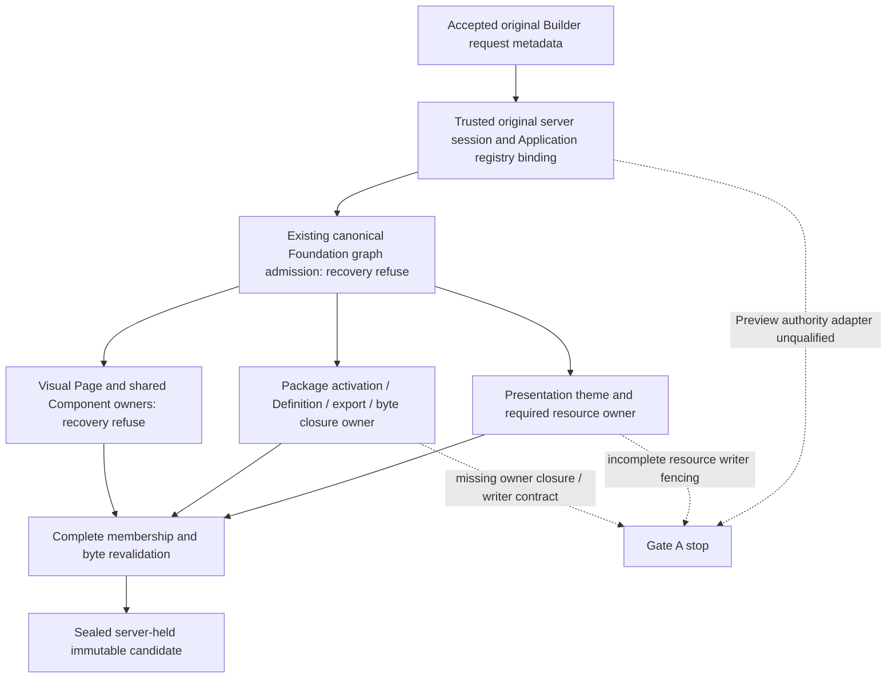

# D6-R2 source-owner, graph and writer map

2026-10-26. Ordinary-source findings only. No owner service, registry, source acquisition, package discovery, journal or lock was executed or inspected as live state. Exact inspected file hashes are in `evidence/d6-r2-real-owner-capture-20261026/inspection-admission.json`.

## Accepted request to real owner

Boxes E, F, G and H are required responsibilities, not implemented D6-R2 components. No synthetic owner or capture function was added.

| Input / owner | Exact existing contract and identity | Graph / read edges | Finding |
| --- | --- | --- | --- |
| Original request | `src/shared/saved-preview-request.ts`: schema/generation, original Application UUID/key, owner-qualified Page, committed hash, node, canonical component/package/version/import/export/Definition revision, owner-selection source/selection generations and echoed subject/session revision. Strict structural parsing preserves source and implementation separately. | Client controller remains unavailable. No new server endpoint exists. | Request metadata is a candidate and consistency binding, never authority or fresh membership. |
| Application identity | `DevelopmentApplicationRegistry.byApplicationId` → `byKey`, provisioning and physical manifest/settings consistency; `appPath(key)` supplies a path, not permanent ownership proof. | Registry constructor/queries involve SQLite and physical files; inspected as source only, never initialized. | Reuse via a trusted server adapter is necessary. A browser key, manifest UUID or fixture mapping cannot replace the registry. |
| Session / policy | `V1DevelopmentIdentity.captureAdmission(req, permissionId, resource)` captures original server session object, user, revision and resource, checks session continuity and authorizes before/after its async check. | Real identity/store execution remains prohibited. | Reusable primitive; no qualified Preview closure-wide authority/disclosure adapter or revocation stream is established here. |
| Saved Page roles | `VisualArtifactService`, Application root `/src/pages`; five roles `.html`, `.css`, `.visual.json`, `.fixtures.json`, `.functions.ts`; service hash is SHA-256(JSON.stringify(role files)). Permanent artifact metadata must resolve uniquely through owner membership. | `list(options)` → Foundation root inspection and `read(locator, options)` → `readRoleBundle(location, options)` → canonical anchor lock → root refusal check → exact role capture. | Recovery-free primitive is available. Missing roles must not be certified as empty bytes merely because the legacy service projection uses `?? ''`. All required identities, roles and diagnostics must be checked by a future capture. |
| Shared Components / Shells | Same Visual owner at `platformComponentsRoot` and Application `/shells`; identity membership and transitive references cannot be skipped to avoid protected reads. | Same explicit refuse options on every list/read. | Live membership unavailable under this authorization. Isolated fixtures are permitted, but cannot stand in for missing package ownership contracts. |
| Installed Definition/package/export | `component-registry.ts:discoverComponents`, `packageEntries`, `activatedPackageEntries`, `installedUiBasePackages`, `getAppPackageAsset`; explicit Definition metadata may coexist with inferred metadata and export fallback. | Plain package reads/discovery; `getActiveAppPackages` → `getAppPackageCatalog` → `ensureAppManifest` / discovery / `refreshPackageCatalog`. No recovery-free owner closure API or shared graph participation is exposed. | **Blocker:** catalog version/manifest/module URL is not immutable complete executable/resource membership. Missing JSON can become null/empty discovery. Fallback IDs and first-preferred candidates cannot establish exact saved-target provenance. |
| Theme / resources | `application-presentation.ts`: active/versioned presentation JSON/CSS/assets, draft assets, runtime module; `getActivePresentationCss` and asset path access are distinct reads. | Main initialize/save/publish/rollback wrappers use `withApplicationMutation`; asset helpers also perform filesystem operations outside a single encompassing graph callback. | **Blocker:** no owner capture contract binds required theme/resource bytes and membership to a completed published version and the capture fence. Draft upload is evidence of incomplete writer coverage, not proof a particular saved Card depends on draft assets. That dependency must be decided authoritatively. |
| Accepted capture/native contracts | `src/preview-contract-model/acquisition.ts` checks supplied observations, membership and resource bytes; `src/client/native-card-preview/admission.ts` pins the canonical Card implementation, Definition and bundle closure. | Model inputs are supplied, not acquired by real owners. Native source binding differs from saved Page/node binding. | Reuse validation semantics only. Calling a model with invented observations, live module URLs or fixture authority is not a real owner implementation. No L1/L2/L3 modification is justified. |

## Participating writer and lock requirements

The existing outer graph is `withApplicationMutation` / `withRuntimeGraphRead` → `withRoleBundleGraph` on canonical `platformComponentsRoot`, identity `visual-runtime-graph-v1`. The `_root` Application argument to the composition lock does not create another graph namespace. Acquire this graph once before role locks. Each role identity is the canonical physical `.visual.json` anchor under its declared owner root. Never call a helper that reacquires the same graph inside capture.

| Writer path | Inspected behavior | Consequence for a complete capture |
| --- | --- | --- |
| Visual mutation handlers in `src/server/index.ts` and composition operations | Relevant mutations use `withApplicationMutation`; role transactions retain their own locks. `VisualArtifactService.saveRoleBundle` alone does not imply outer graph acquisition. | Reuse existing ordering, but inventory all caller-level participants; do not claim every direct service/external writer is fenced. |
| Package installation | `package-installer.ts:36–86` stages/copies and renames a package, then updates catalog/history. Inspected platform/app routes call installation directly; no enclosing `withApplicationMutation` on those paths. | Package add/membership or same-scope implementation changes are not certified by the Visual graph lock. This is an implementation contract gap, not a diagnosis of current installed state. |
| Package enable/disable | `packages.ts:105–136` → `setAppPackageDeclaration`; `app-manifests.ts:56–73` reads/normalizes then atomically writes declarations. Inspected routes call enable/disable directly. | Activation membership is not fenced by the capture graph on these paths. Atomic file replacement alone does not certify whole-closure consistency or prevent ABA changes between two observations. |
| Package discovery side effects | `ensureAppManifest` may create a manifest when absent; catalog refresh is a discovery/state operation, not a sealed-source acquisition contract. | Do not import ordinary discovery into R2 and describe it as a recovery-free, nonmutating source owner. Separate side effects must be admitted and missing state must refuse. |
| Presentation metadata | Initialize/save/publish/rollback wrappers acquire the existing graph. | Useful participating paths, but insufficient to certify every resource byte writer. |
| Presentation assets | `uploadPresentationAsset` initializes, then writes asset bytes before invoking locked `savePresentationDraft`; copy-to-version helper copies resource trees without owning an encompassing graph callback itself. | Whole resource membership/bytes must be covered by an owner contract and caller inventory. A later locked metadata save does not retroactively fence the preceding byte write. |
| External package/build/file actors | No source-backed universal graph participation or immutable publication certificate was established. | A complete claim needs an explicit supported-writer assumption plus enforceable owner epochs/fencing or immutable snapshots. Two reads alone do not establish arbitrary-writer coherence. |

The minimum missing contract is an **existing-owner package/presentation closure read boundary with authoritative complete membership and immutable byte/revision evidence, plus explicit writer participation/fencing and invalidation**. It must cover activation/export/Definition/package ownership and required theme/resources under the capture's ordering. This finding requires no protected acquisition or machine investigation. Adding writer coordination or a new immutable publication contract is not silently included in R2: it requires a concrete separate scope decision before implementation.

## Explicit recovery-free edges for a later implementation

1. Outer graph admission must receive `recovery: 'refuse'`, cancellation and the approved acquisition budget.
2. Every Visual Page, shared Component and Shell root inspection/list/read must receive the same mode through the existing owner. It is not ambient and is not inherited merely because the graph was acquired in refuse mode.
3. Package/presentation owners need their own admitted read-only closure contract; no existing Foundation mode can be assumed to fence plain filesystem reads or uncoordinated package writers.
4. Final revalidation must repeat complete identity/membership/byte evidence under the same admitted ownership contract, including package activation and resource revisions. Rechecking Page hashes only is insufficient.
5. Do not call legacy `visualPreviewRevision` as the new capture: it acquires its own graph, uses default workspace discovery, skips absent shared Component matches and reuses initially discovered package metadata during rechecks. Its legacy behavior remains unchanged.

No executable product dependency closure was admitted: Gate A failed before runtime design could be grounded in complete owner contracts. The inspected dependency map is not permission to initialize the registry, package catalog, protected readers or backend.
